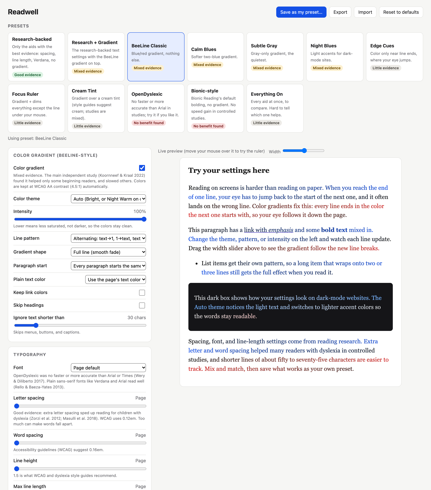

# Readwell

A browser extension for experimenting with reading aids: color-gradient line
guiding, dyslexia-friendly fonts, adjustable spacing, a reading ruler,
bionic-style bolding and color tints. Mix them, compare presets, and find out
what actually helps you read. It also works when Dark Reader is turned on, and
inside iframe-based book readers.



## Why "experiment"?

Readwell is built for trying things, not prescribing them. Every aid here has
fans, but the evidence behind them varies a lot, and people differ more than
the studies do. So every preset and setting on the options page carries an
evidence label (**Good**, **Mixed**, **Little**, **No benefit found**), with the
study behind it:

- **Spacing and line length: good evidence.** Extra letter spacing sped up
  reading for children with dyslexia (Zorzi et al. 2012; Masulli et al. 2018).
  The **Research-backed** preset uses only these aids, with WCAG 1.4.12 spacing
  values and a plain sans-serif font, which also reads well in studies
  (Rello & Baeza-Yates 2013).
- **Gradient line guiding: mixed.** The main independent study (Koornneef &
  Kraal 2022) found it helped some beginning readers and slowed others down.
- **Rulers, tints, edge cues: little evidence.** Not formally studied; some
  readers find them more comfortable.
- **OpenDyslexic and bionic-style bolding: no benefit found.** OpenDyslexic was
  no faster or more accurate than Arial or Times (Wery & Diliberto 2017), and
  bionic bolding showed no speed gain in controlled tests.

None of this says what will work for *you*, so treat it as an experiment on
yourself:

1. **Change one thing at a time.** The live preview updates as you adjust
   anything, and there's a dark box to check how it looks on dark sites.
2. **Use the same kind of text.** Compare on articles you'd normally read, not
   the easiest page you can find.
3. **Give each setup a few days.** Anything new feels strange at first; what
   matters is how it feels once the novelty wears off.
4. **Notice comfort as well as speed.** Less eye strain or fewer lost lines is a
   real result even if you don't read any faster.
5. **Save what works** with **Save as my preset…**, and **Export** it to keep a
   record or share it.

**Everything On** turns on every aid at once, a quick way to see what each one
does before you narrow it down. It's a bad way to judge them, though: with
everything on, you can't tell which one is helping.

- Extension ID: `lineglide@local` (registered on addons.mozilla.org, so **never change it**)
- Minimum Firefox: 140 on desktop, 142 on Android
- Tools: Node.js and `npx web-ext` (downloaded automatically on first use)

## Files

| File | Purpose |
|---|---|
| `manifest.json` | Extension manifest. Bump `version` here before every signed release. |
| `config.js` | Defaults, color themes, fonts and presets (shared by every page). |
| `engine.js` | The reading-aid engine: word wrapping, gradient, ruler, tint. |
| `content.js` | Runs in every page and frame; starts the engine and recolors when Dark Reader toggles. |
| `background.js` | Per-tab on/off state and the keyboard shortcut (Alt+Shift+B). |
| `popup.*`, `options.*` | Toolbar popup and full settings page. |
| `web-ext-config.mjs` | Settings `web-ext` reads automatically: which files to leave out of builds, plus signing defaults. Not shipped. |
| `README.md`, `docs/` | This file and its screenshot. Not shipped. |

Anything that isn't part of the extension (docs, test pages, saved web pages)
must be left out of the package. Add it to `ignoreFiles` in `web-ext-config.mjs`,
or keep it outside this folder. Pages that load remote scripts get flagged in
review. To see exactly what will ship:

```sh
npx web-ext build && unzip -l web-ext-artifacts/readwell-*.zip
```

## Check for problems

```sh
npx web-ext lint
```

Aim for 0 errors and 0 warnings. Mozilla runs the same checks when you sign.

## Try it without installing

```sh
npx web-ext run
```

This opens a temporary Firefox profile with the extension loaded and reloads it
when files change.

## Build an unsigned package

```sh
npx web-ext build
```

This writes `web-ext-artifacts/readwell-<version>.zip`. Regular Firefox
**won't install** an unsigned package. It only works in Firefox Developer
Edition, Nightly or ESR after you set `xpinstall.signatures.required` to `false`
in `about:config`. For a permanent install in regular Firefox, sign it (below).

## Sign it (unlisted, never published)

"Unlisted" signing means Mozilla signs the file but never lists it on the add-on
store. Only people you give the `.xpi` file to can install it. The review is
automated and usually takes a few minutes.

### One-time setup: API keys

1. Sign in at <https://addons.mozilla.org/developers/addon/api/key/> and generate
   credentials. You get a **JWT issuer** (`user:…`) and a **JWT secret**.
2. Store them in the macOS Keychain, never in this folder:

   ```sh
   security add-generic-password -U -a "$USER" -s amo-jwt-issuer -l "AMO API key (web-ext)" -w 'user:XXXX:XXX'
   security add-generic-password -U -a "$USER" -s amo-jwt-secret -l "AMO API secret (web-ext)" -w 'YOUR_SECRET'
   ```

   Check that they're there: `security find-generic-password -s amo-jwt-issuer -w`

### Every release

1. **Bump `version`** in `manifest.json` (e.g. `2.1.1` → `2.1.2`). Mozilla
   rejects a version number it has already received, even one still in review.
2. **Lint** (see above) and fix anything it reports.
3. **Sign:**

   ```sh
   WEB_EXT_API_KEY=$(security find-generic-password -s amo-jwt-issuer -w) \
   WEB_EXT_API_SECRET=$(security find-generic-password -s amo-jwt-secret -w) \
   npx web-ext sign --artifacts-dir ../signed
   ```

   (`--channel=unlisted` and the ignore list come from `web-ext-config.mjs`.)

   It uploads, prints `Waiting for validation…` then `Waiting for approval…`,
   and saves the signed `.xpi` to `../signed/` when approval comes through.
4. **Install:** in Firefox, open `about:addons`, click the gear icon, choose
   **Install Add-on From File…**, and pick the new `.xpi`. The same ID means it
   upgrades in place and keeps your settings.
5. **Reload open tabs.** Firefox doesn't add content scripts to tabs that were
   already open, so the popup says "not available" there until you reload.

## Troubleshooting

| Symptom | Cause / fix |
|---|---|
| Stuck on "Waiting for approval…" | Mozilla's review queue is slow. The upload is safe; leave it running. If web-ext gives up waiting, the version stays queued: download the signed file later from the add-on's page in the AMO Developer Hub instead of uploading again. |
| "Version already exists" | Bump `version` in `manifest.json`. |
| Popup says "not available for this page" | Reload the tab. If that doesn't help, open `about:addons` → Readwell → **Permissions** and allow access to all websites. Firefox never lets extensions run on `about:` pages or addons.mozilla.org. |
| Keys stopped working | They were regenerated or revoked on AMO. Generate new ones and rerun the Keychain step. |
| A scratch or test file ended up in the package | Add it to `ignoreFiles` in `web-ext-config.mjs`, or delete it. |
| `rm` asks "remove …?" and nothing gets deleted | `rm` on this Mac asks for confirmation. Use `rm -f` in scripts. |
